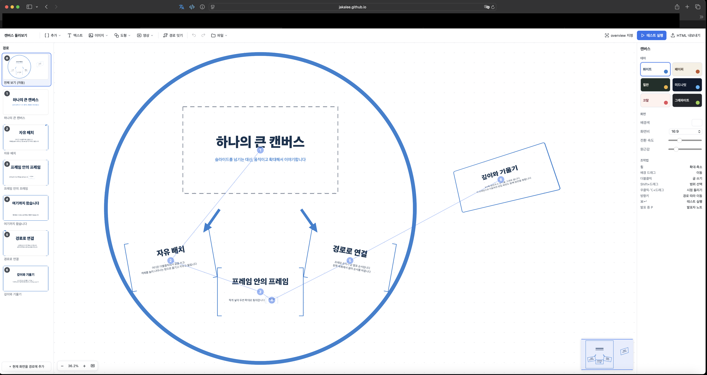

# simple impress editor

설치 없이 브라우저에서 쓰는 impress.js 프레젠테이션 편집기입니다.
슬라이드를 넘기는 대신, 큰 캔버스 하나에 내용을 놓고 움직이고 확대하며 발표합니다.

**[바로 써보기](https://jakalee.github.io/simpress/)**

## 특징

- **무한 캔버스:** 휠로 확대·축소하고, 배경을 끌어 이동합니다.
- **프레임과 경로:** 프레임을 놓고 순서를 이으면 그 순서가 발표 순서가 됩니다.
- **변형 링:** 객체를 누르면 나오는 링으로 옮기고, 키우고, 돌립니다.
- **3D:** Z 깊이와 X·Y축 회전을 쓸 수 있고, 편집 화면과 발표 화면이 같게 보입니다.
- **콘텐츠:** 텍스트, 이미지, 도형, 영상. 이미지를 여러 장 고르면 격자로 놓고 경로까지 연결합니다.
- **발표 도구:** 발표자 노트(P키), 슬라이드 탐색기, 진행 표시.
- **저장:** 자동 저장, 실행 취소, JSON 저장·불러오기.
- **내보내기:** 이미지까지 들어 있는 HTML 파일 하나로 내보냅니다. 받는 사람은 설치할 것이 없습니다.

## 사용법

위의 링크를 열거나, [`index.html`](index.html)을 내려받아 더블클릭하면 됩니다. 서버와 빌드는 필요 없습니다.

작성한 내용은 쓰는 사람의 브라우저에만 저장되고 어디로도 전송되지 않습니다.
브라우저 데이터를 지우면 함께 사라지므로, 중요한 문서는 JSON으로 저장해 두세요.

| 조작 | 동작 |
|---|---|
| 휠 | 확대·축소 |
| 배경 드래그 | 이동 |
| 빈 곳 더블클릭 | 글쓰기 |
| Shift + 드래그 | 범위 선택 |
| 우클릭 또는 ⌥ + 드래그 | 시점 돌리기 |
| 방향키 | 경로 따라 이동 |
| ⌘/Ctrl + Enter | 테스트 실행 |
| 발표 중 P | 발표자 노트 |
| 발표 중 O | 전체 보기 |

## 배포 구조

편집기와 impress.js가 `index.html` 하나에 포함되어 있습니다. 별도의 서버나 빌드 과정 없이 이 파일을 브라우저에서 열어 사용할 수 있습니다.

## 사용자 콘텐츠

사용자가 삽입한 이미지, 영상, 글꼴 및 기타 콘텐츠의 이용 권한과 공개·재배포 책임은 해당 사용자에게 있습니다. 공개하기 전에 원저작자의 이용 조건을 확인하세요.

## 라이선스

편집기 코드는 [MIT License](LICENSE)로 배포됩니다. 사용자가 작성하거나 삽입한 콘텐츠에는 이 라이선스가 적용되지 않습니다.

포함된 impress.js 2.0.0의 저작권 및 라이선스 고지는 [THIRD_PARTY_NOTICES.md](THIRD_PARTY_NOTICES.md)에 있습니다.
